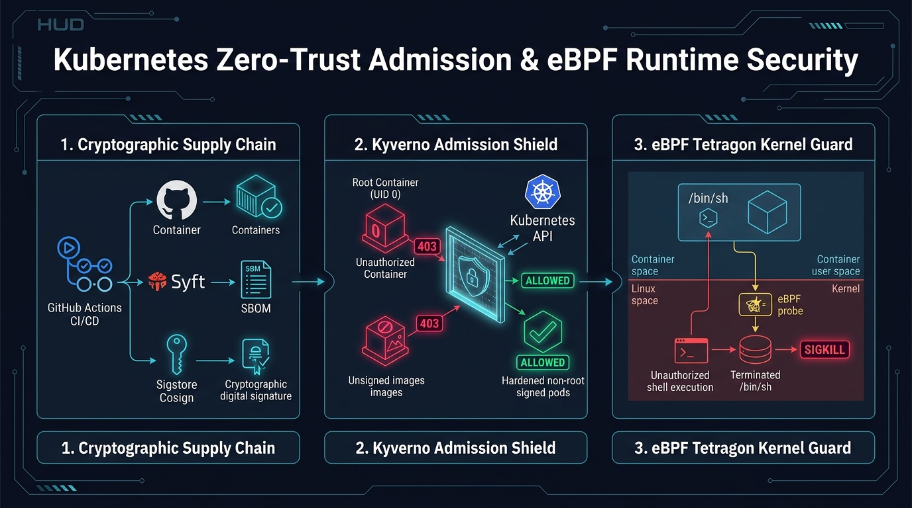
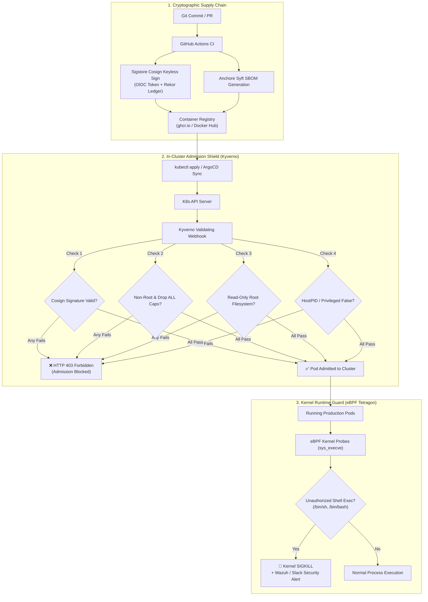

# Kubernetes Zero-Trust Admission Shield & eBPF Runtime Guard

[](https://kubernetes.io)
[](https://kyverno.io)
[](https://sigstore.dev)
[](https://tetragon.cilium.io)
[](LICENSE)

An enterprise-grade, in-cluster Kubernetes security reference architecture enforcing **cryptographic supply chain admission control** (Kyverno + Sigstore Cosign), **Pod Security Standards (Restricted)**, and **kernel-level runtime anomaly detection** via eBPF (Cilium Tetragon).

<p align="center">
  
</p>

---

## 🏛️ System Architecture



---

## 🛡️ Threat Model & Policy Defense Matrix

| Threat / CWE ID | Attack Vector | Policy Defense Mechanism | Enforcement Level |
| :--- | :--- | :--- | :--- |
| **CWE-250 / Container Breakout** | Attacker deploys pod running as UID 0 (root) to overwrite host storage. | `cluster-policy-disallow-root.yaml`: Enforces `runAsNonRoot: true` and non-zero UID/GID. | **Enforce** (Blocks pod creation) |
| **CWE-276 / Privileged Escapes** | Container uses `privileged: true` or `hostPID: true` to access host processes. | `cluster-policy-block-privileged-escapes.yaml`: Forbids host namespaces and elevated flags. | **Enforce** (Blocks pod creation) |
| **Supply Chain Tampering** | Attacker injects malicious payload into unverified public image tag. | `cluster-policy-verify-cosign-signatures.yaml`: Validates cryptographic signature via Rekor log. | **Enforce** (Blocks unsigned images) |
| **Resource Starvation / DoS** | Rogue container consumes all node memory, causing OOMKills of neighboring pods. | `cluster-policy-require-resource-quotas.yaml`: Enforces explicit CPU/Memory requests & limits. | **Enforce** (Blocks unbounded pods) |
| **Post-Exploitation Shell Spawn** | Remote Code Execution (RCE) payload executes interactive `/bin/sh` in container. | `tetragon-shell-exec-monitor.yaml`: Kernel-level eBPF kprobe terminates process with `Sigkill`. | **Runtime Block** (SIGKILL) |

---

## 📁 Repository Structure

```
.
├── policies/                               # Kyverno ClusterPolicy Manifests
│   ├── cluster-policy-disallow-root.yaml           # Enforces non-root, read-only rootfs, drop ALL caps
│   ├── cluster-policy-verify-cosign-signatures.yaml# Keyless Sigstore Cosign signature verification
│   ├── cluster-policy-block-privileged-escapes.yaml# Blocks hostPID, hostNetwork, hostIPC & privileged
│   └── cluster-policy-require-resource-quotas.yaml # Enforces CPU/Memory requests and limits
├── runtime-ebpf/                           # eBPF Runtime Security
│   └── tetragon-shell-exec-monitor.yaml    # Cilium Tetragon TracingPolicy (sys_execve kill switch)
├── test-workloads/                         # Attack Simulation Manifests
│   ├── bad-pod-root-user.yaml              # Violates non-root policy (UID 0)
│   ├── bad-pod-host-pid.yaml               # Violates host namespace isolation
│   └── good-pod-hardened-signed.yaml       # Fully compliant production-grade workload
├── scripts/                                # Automation & Validation Tooling
│   ├── setup-cluster.sh                    # Automated Kind + Kyverno bootstrap
│   ├── simulate-admission-attacks.sh       # Automated attack simulation & test runner
│   └── teardown.sh                         # Clean cluster teardown
├── LICENSE                                 # Apache 2.0
└── README.md                               # Architecture & reproduction guide
```

---

## 🚀 Quickstart & Reproduction Guide

### Prerequisites
- Docker Engine $\ge$ 24.0
- [`kind`](https://kind.sigs.k8s.io/) $\ge$ 0.20
- [`kubectl`](https://kubernetes.io/docs/tasks/tools/) $\ge$ 1.28
- [`helm`](https://helm.sh/) $\ge$ 3.12

### Step 1: Bootstrap the Hardened Cluster
Run the automated bootstrap script to spin up a Kind cluster, provision the `production` namespace, and install the Kyverno admission controller:
```bash
cd scripts
./setup-cluster.sh
```

### Step 2: Execute Attack Simulation Drills
Run the automated attack simulator to test the policy enforcement engine against real exploit manifests:
```bash
./simulate-admission-attacks.sh
```

**Expected Terminal Output**:
```text
==========================================================
 [ATTACK SIMULATION] Testing Kyverno Admission Shield
==========================================================

>> TEST 1: Attempting to deploy Pod running as ROOT...
Error from server: admission webhook "validate.kyverno.svc" denied the request: 
Running as root is strictly prohibited. Set 'securityContext.runAsNonRoot: true' and a non-zero 'runAsUser'.
✅ PASSED: Kyverno successfully BLOCKED root user pod!

>> TEST 2: Attempting to deploy Pod with hostPID & privileged: true...
Error from server: admission webhook "validate.kyverno.svc" denied the request: 
Sharing host namespaces (hostPID, hostIPC, hostNetwork) is strictly forbidden.
✅ PASSED: Kyverno successfully BLOCKED host namespace breakout!

>> TEST 3: Deploying hardened, non-root, read-only rootfs Pod...
pod/good-pod-hardened created
NAME                 READY   STATUS    RESTARTS   AGE
good-pod-hardened    1/1     Running   0          2s
✅ PASSED: Hardened pod successfully ADMITTED by policy engine!

==========================================================
 Admission Control Attack Simulation Complete!
 All Zero-Trust Admission Gates Verified.
==========================================================
```

### Step 3: Teardown
To cleanly destroy the sandbox cluster and reclaim resources:
```bash
./teardown.sh
```

---

## 🎯 Interview Deep Dive: Key Talking Points

1. **Why In-Cluster Admission Control beats CI/CD Scanners alone**:
   > *"CI/CD scanners are necessary but not sufficient. If an attacker gains access to a developer's kubeconfig, an unprivileged service account, or compromises a staging registry, they can bypass CI completely and run unvetted containers directly on the cluster. Kyverno validates every incoming API request at the admission webhook level, ensuring no code enters production without passing policy checks."*

2. **Why Keyless OIDC Cosign is superior to Static GPG/KMS Keys**:
   > *"Traditional image signing requires storing private keys in CI secrets (e.g. GitHub Secrets or Jenkins credentials), which creates a critical credential rotation and leak vulnerability. Sigstore keyless signing issues short-lived cryptographic certificates tied to GitHub Actions OIDC identity tokens, publishing audit proofs to the Rekor transparency ledger with zero stored private keys."*

3. **Why Read-Only Root Filesystems mitigate RCE**:
   > *"Most web application exploits rely on dropping secondary binaries or modifying configuration files in `/tmp` or `/etc`. By combining `readOnlyRootFilesystem: true` with non-root user execution, an attacker with an RCE payload cannot download tools, compile exploits, or alter running binaries on the container layer."*

---

## 📜 License
Licensed under the Apache License, Version 2.0. See [LICENSE](LICENSE) for details.

